<p align="center">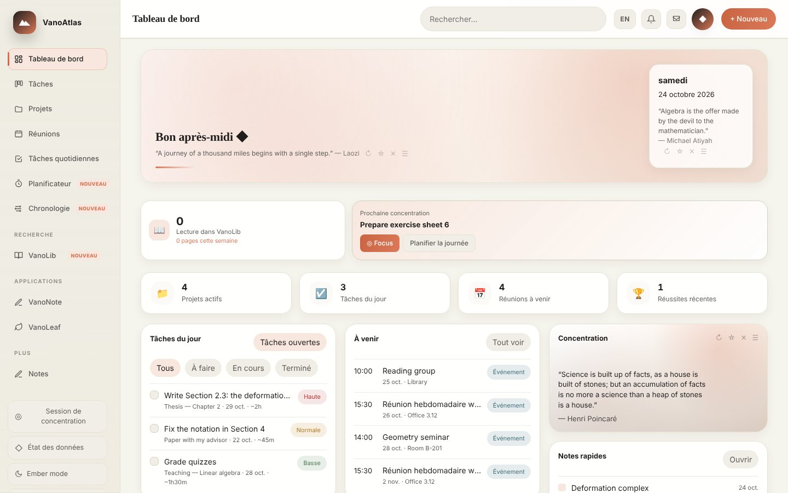</p>

<h1 align="center">VanoAtlas</h1>
<p align="center"><b>L'espace de travail du chercheur, sur votre propre ordinateur.</b><br>
Projets, tâches, réunions, routine quotidienne, notes, articles et LaTeX dans une seule application privée.</p>
<p align="center"><a href="https://github.com/yassine-aitmohamed/vanoatlas/actions/workflows/checks.yml"></a> <a href="https://github.com/yassine-aitmohamed/vanoatlas/releases/latest"></a> <a href="LICENSE"></a> </p>
<p align="center"><a href="README.md">English version</a></p>

---

## Installation en une commande

**macOS / Linux** (Terminal) :

```bash
curl -fsSL https://raw.githubusercontent.com/yassine-aitmohamed/vanoatlas/main/install.sh | bash
```

**Windows** (PowerShell) :

```powershell
irm https://raw.githubusercontent.com/yassine-aitmohamed/vanoatlas/main/install.ps1 | iex
```

L'installateur télécharge VanoAtlas dans votre dossier personnel, prépare tout, place un raccourci **VanoAtlas** sur le Bureau et ouvre l'application à l'adresse http://localhost:8770.
Il faut seulement Python 3. Sous Windows, l'installateur installe Python avec `winget` s'il manque.
Pour compiler du LaTeX dans VanoLeaf, installez une distribution TeX : MacTeX sur macOS, MiKTeX sur Windows, TeX Live sur Linux.

Vous préférez un téléchargement ? Prenez le zip de votre système sur la page [Releases](https://github.com/yassine-aitmohamed/vanoatlas/releases), décompressez-le et lancez `install.sh` (macOS) ou double-cliquez sur `install.bat` (Windows).

## Pourquoi VanoAtlas

- **Pensé pour les chercheurs.** Suivre les lemmes et théorèmes avec leurs dépendances, tenir une bibliographie, suivre les nouveaux preprints arXiv, écrire en LaTeX, organiser la semaine autour des séminaires et des réunions avec la direction. Les applications de tâches classiques ne font rien de cela.
- **Privé par conception.** Vos données restent dans un seul dossier sur votre machine (`~/.vanoatlas`). Pas de compte, pas de cloud, pas de pistage. La synchronisation des calendriers et les sauvegardes restent désactivées tant que vous ne les activez pas.
- **Tout au même endroit.** Les tâches sont liées aux projets, les notes aux résultats et aux références, les réunions apparaissent dans le planificateur.
- **Rapide et léger.** Le cœur de l'application est un seul fichier Python, sans dépendance. Un article typique se recompile en local en environ une seconde.
- **Hors ligne.** Tout continue de fonctionner sans internet.
- **Bilingue.** Français et anglais, en un clic.
- **15 thèmes.** Clairs, sombres et saisonniers animés.
- **Libre et gratuit.** Licence MIT.

## Visite

| | |
|---|---|
| 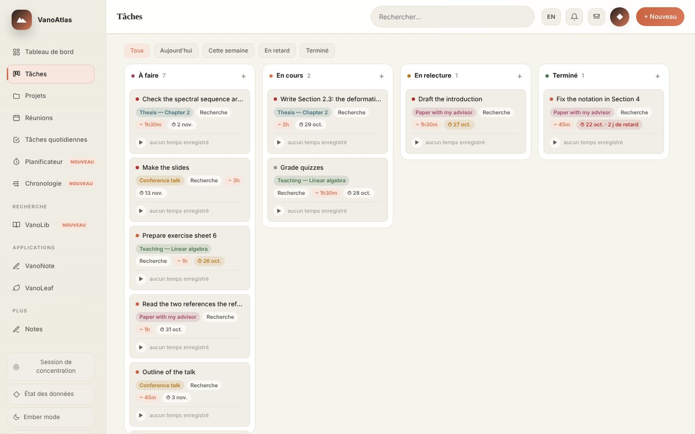 **Tâches** : tableau kanban avec priorités, échéances, estimations et sous-tâches. | 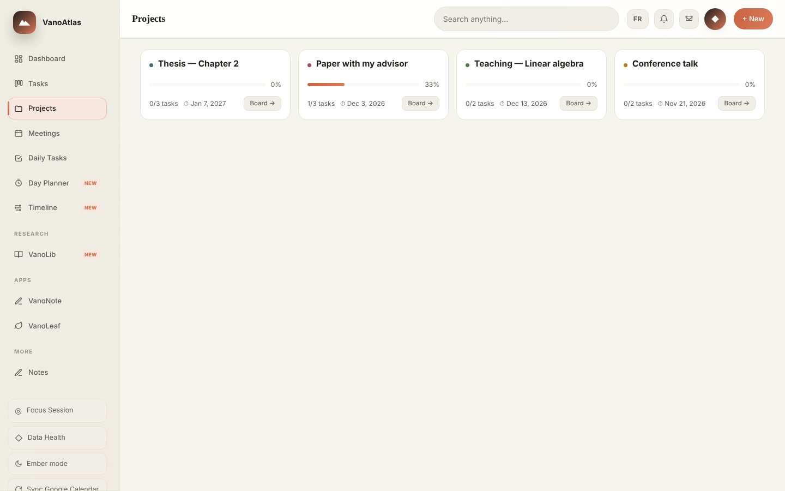 **Projets** : avancement, tâches, jalons et notes de chaque projet. |
| 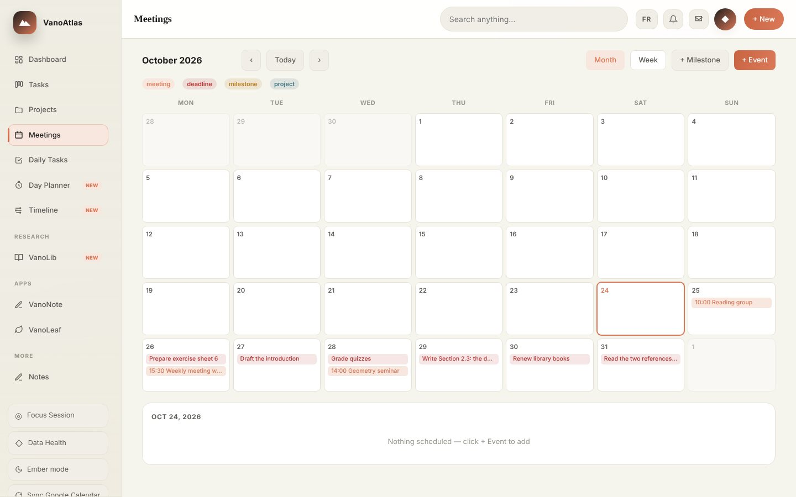 **Réunions** : calendrier mois et semaine, synchronisation Google Agenda et iCloud en option. | 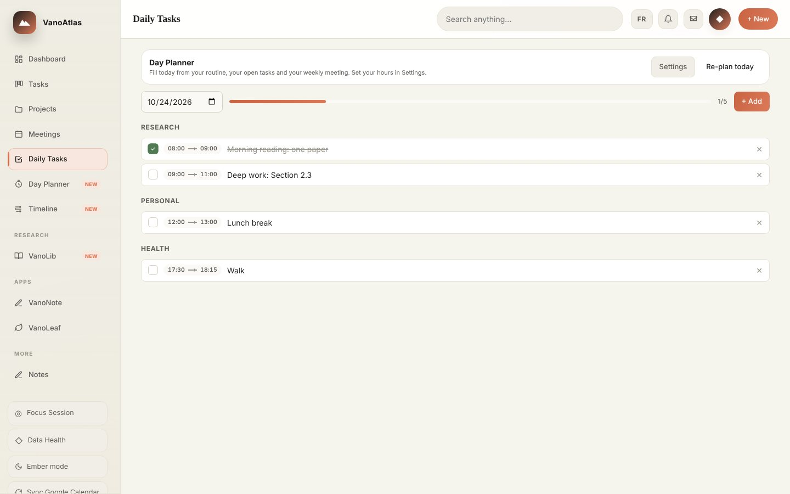 **Tâches quotidiennes** : la routine du jour, remplie en un clic par le planificateur. |
| 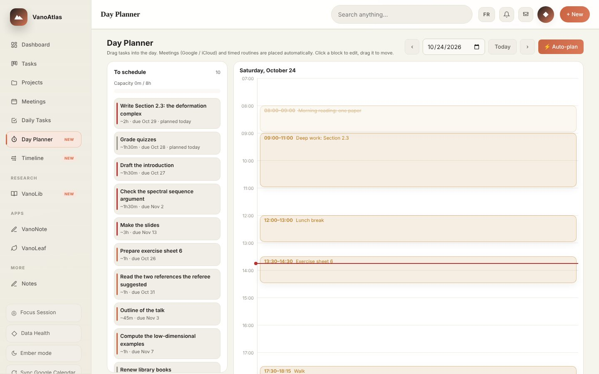 **Planificateur** : glisser les tâches dans des créneaux à côté des réunions. | 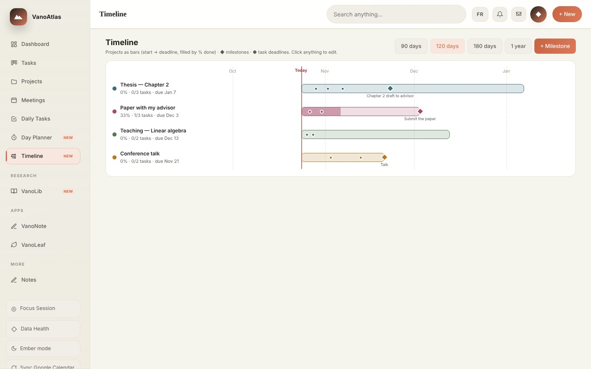 **Chronologie** : projets, jalons et échéances sur une seule ligne. |
| 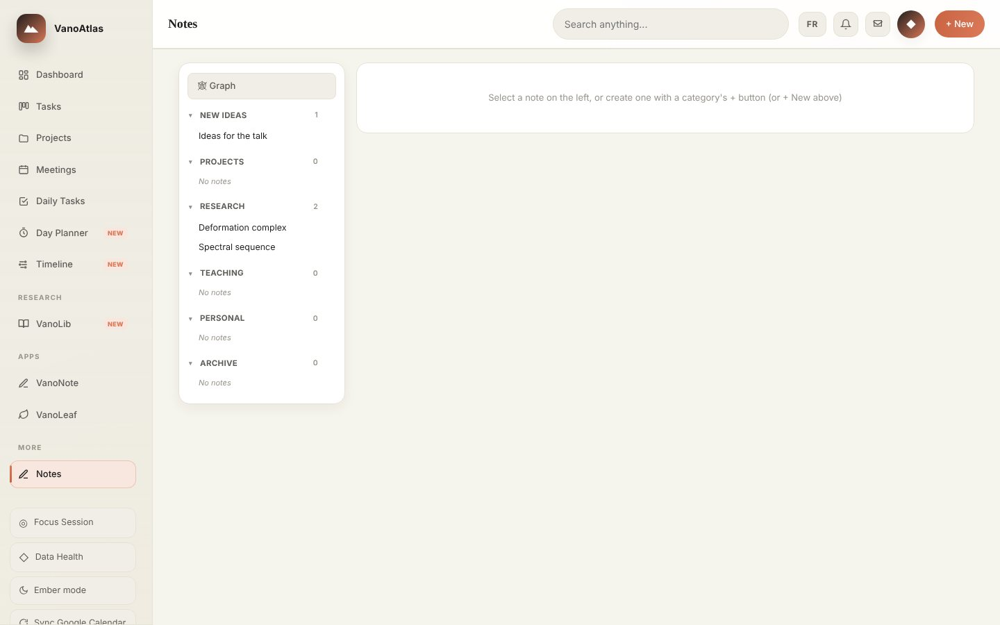 **Notes** : notes Markdown et LaTeX avec liens `[[wiki]]` et notes manuscrites. | 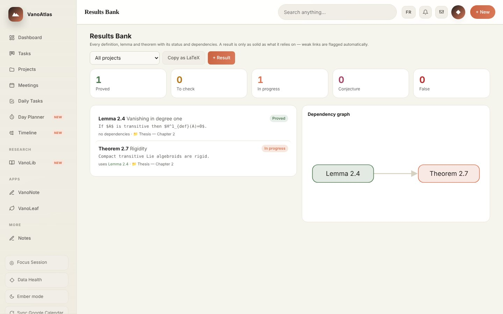 **Banque de résultats** : définitions, lemmes et théorèmes avec statut et dépendances, exportés en LaTeX. |

### VanoLeaf : LaTeX sur votre ordinateur

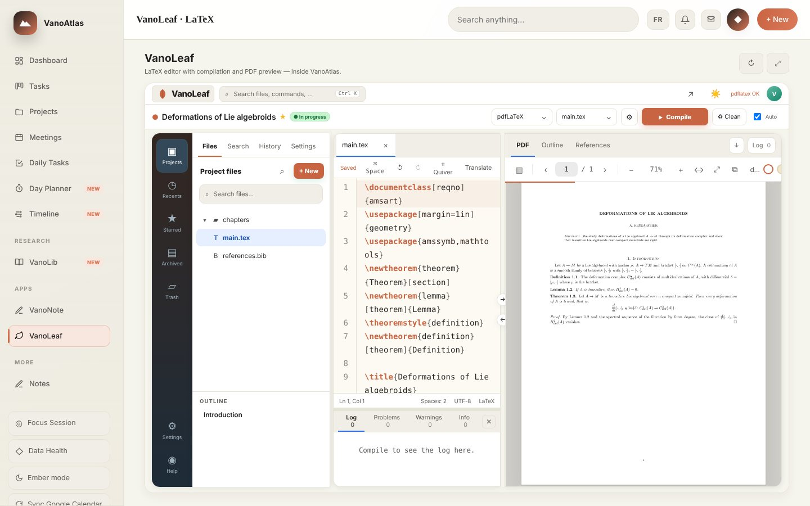

Éditeur dans l'esprit d'Overleaf : fichiers de projet, modèles (articles, thèses, beamer, posters), compilation en direct avec préambule mis en cache, aperçu PDF et clic vers la source (SyncTeX). Aucune limite de temps de compilation, aucun besoin d'internet.

### VanoNote et VanoLib

**VanoNote** est un cahier manuscrit et un tableau blanc compatible avec les tablettes à stylet.
**VanoLib** garde une bibliothèque arXiv locale dans les catégories choisies, avec lecteur PDF, surlignage et file de lecture.

### Thèmes

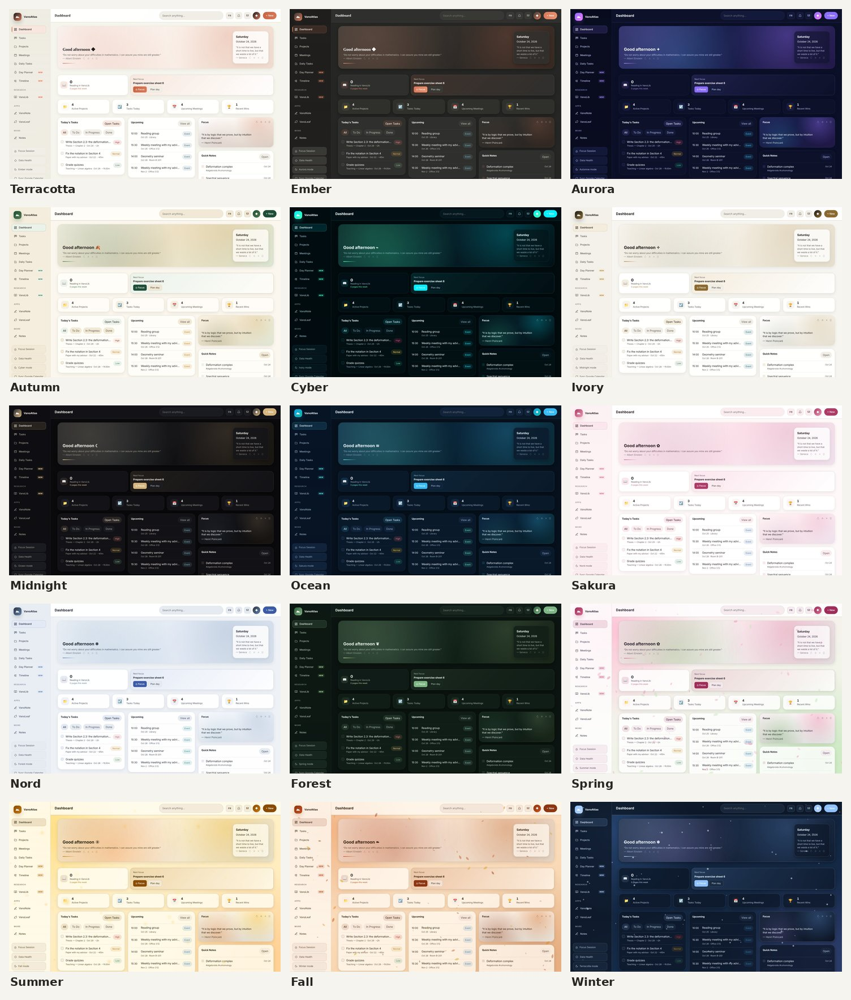

## Auteur

VanoAtlas est écrit et maintenu par **Yassine Ait Mohamed**, doctorant en mathématiques à l'Université de Sherbrooke. C'est d'abord un outil pour ma propre recherche, partagé dans l'espoir qu'il serve à d'autres.

- Site : [yassine-aitmohamed.github.io](https://yassine-aitmohamed.github.io)
- Bugs et idées : [ouvrir une issue](https://github.com/yassine-aitmohamed/vanoatlas/issues)

## Licence

MIT. Voir [LICENSE](LICENSE).
