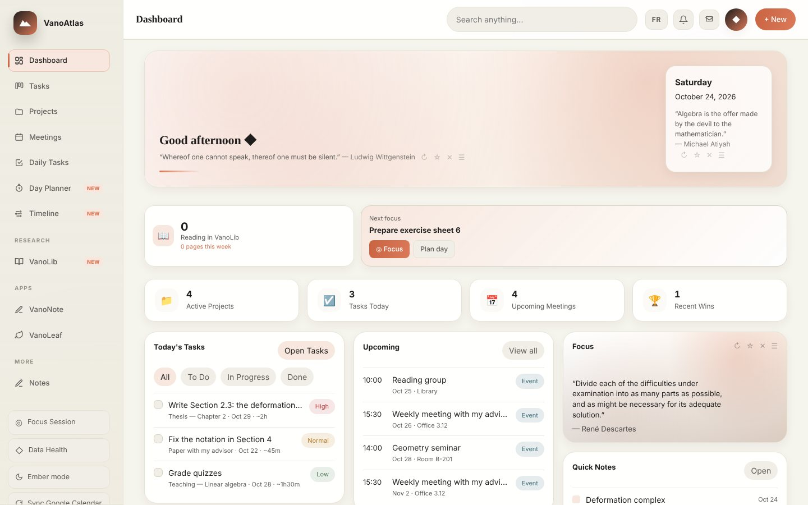
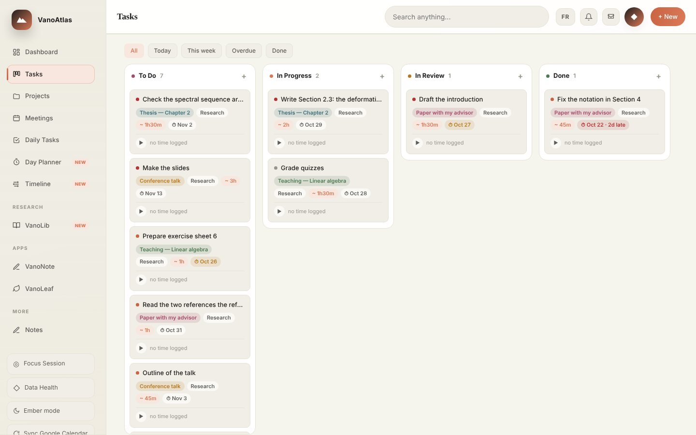
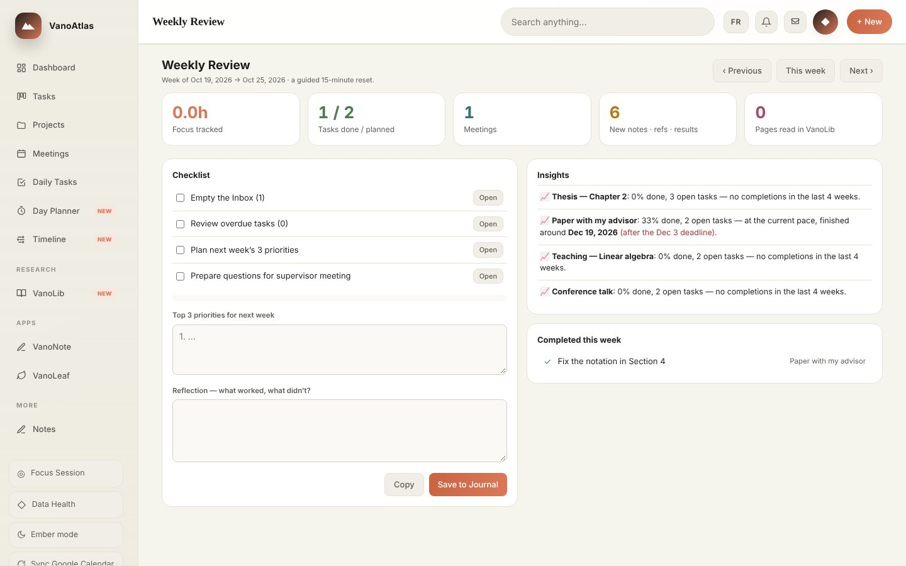
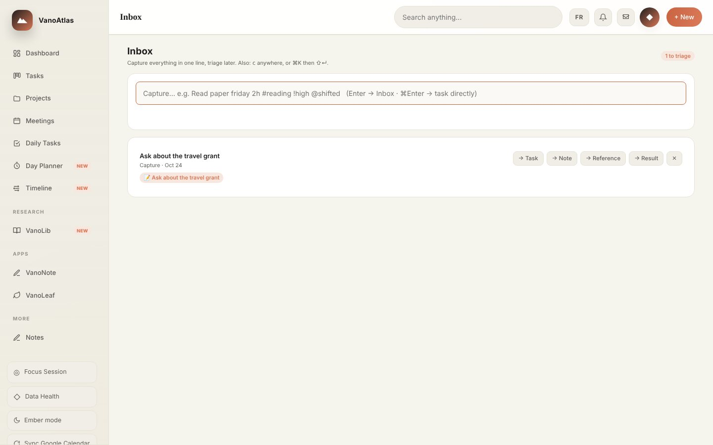
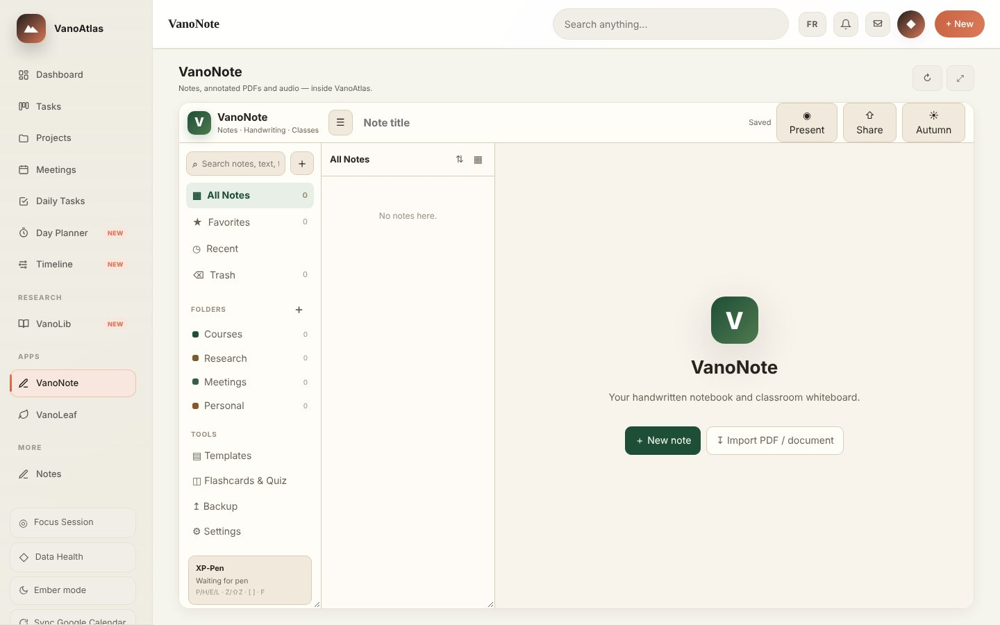

<p align="center"></p>

<h1 align="center">VanoAtlas</h1>
<p align="center"><b>The research workspace that lives on your computer.</b><br>
Projects, tasks, meetings, daily routine, notes, papers and LaTeX in one private app.</p>
<p align="center"><a href="https://github.com/yassine-aitmohamed/vanoatlas/actions/workflows/checks.yml"></a> <a href="https://github.com/yassine-aitmohamed/vanoatlas/releases/latest"></a> <a href="LICENSE"></a> </p>
<p align="center"><a href="README.fr.md">Version française</a></p>

---

## Install in one command

**macOS / Linux** (Terminal):

```bash
curl -fsSL https://raw.githubusercontent.com/yassine-aitmohamed/vanoatlas/main/install.sh | bash
```

**Windows** (PowerShell):

```powershell
irm https://raw.githubusercontent.com/yassine-aitmohamed/vanoatlas/main/install.ps1 | iex
```

The installer downloads VanoAtlas to your home folder, sets everything up, puts a **VanoAtlas** shortcut on your Desktop and opens the app at http://localhost:8770.
It only needs Python 3. On Windows it installs Python for you with `winget` when it is missing.
To compile LaTeX in VanoLeaf, install a TeX distribution: MacTeX on macOS, MiKTeX on Windows, TeX Live on Linux.

Prefer a download? Take the zip for your system from the [Releases](https://github.com/yassine-aitmohamed/vanoatlas/releases) page, unzip it and run `install.sh` (macOS) or double-click `install.bat` (Windows).

## Why VanoAtlas

- **Built for researchers.** Track lemmas and theorems with their dependencies, keep a bibliography, follow new arXiv preprints, write in LaTeX, plan the week around seminars and advisor meetings. General to-do apps do none of this.
- **Private by design.** Your data stays in one folder on your machine (`~/.vanoatlas`). No account, no cloud, no tracking. Calendar sync and backups are off until you turn them on.
- **Everything in one place.** Tasks link to projects, notes link to results and references, meetings appear in the day planner. No more switching between five apps.
- **Fast and light.** The core app is a single Python file using only the standard library. A typical paper recompiles locally in about a second.
- **Works offline.** Plane, train, library basement: everything keeps working. The phone version on the same Wi-Fi also caches your data.
- **Bilingual.** English and French, switched with one click.
- **15 themes.** Light, dark and animated seasonal themes.
- **Free and open source.** MIT license.

## A tour

| | |
|---|---|
|  **Tasks**: kanban board with priorities, deadlines, estimates and subtasks. |  **Projects**: progress, tasks, milestones and notes for each project. |
|  **Meetings**: month and week calendar, optional Google Calendar and iCloud sync. |  **Daily Tasks**: your routine for the day, filled in one click by the Day Planner. |
|  **Day Planner**: drag tasks into time blocks next to your meetings. |  **Timeline**: projects, milestones and deadlines on one line. |
|  **Notes**: Markdown and LaTeX notes with `[[wiki links]]` and handwritten notes. |  **Results Bank**: definitions, lemmas and theorems with status and dependencies, exported to LaTeX. |
|  **Weekly Review**: a guided 15-minute review of your week. |  **Inbox**: capture in one line (`Read paper friday 2h #reading !high`), sort later. |

### VanoLeaf: LaTeX on your computer


Overleaf-style editor with project files, templates (articles, theses, beamer, posters), live compilation with a cached preamble, PDF preview and click-to-source (SyncTeX). No compile time limit, no internet needed.

### VanoNote and VanoLib



**VanoNote** is a handwritten notebook and whiteboard that supports pen tablets.
**VanoLib** keeps a local arXiv library in the categories you choose, with a PDF reader, highlights and a reading queue.

### Themes


### English and French

| English | Français |
|---|---|
|  |  |

## Try it with sample data

```bash
VANOATLAS_HOME=~/.vanoatlas-demo ./start.command
python3 tools/demo_data.py
```

Reload the page. Your real data in `~/.vanoatlas` is not touched.

## Settings

| Variable | Default | Meaning |
|---|---|---|
| `VANOATLAS_HOME` | `~/.vanoatlas` | Data folder |
| `VANOATLAS_PORT` | `8770` | Port of the web interface |
| `VANOLIB_DIR` | `./VanoLib` | VanoLib folder |

Open VanoAtlas on your phone: start it on your computer and visit the address printed in the terminal (`http://<your-computer>:8770`) from a phone on the same Wi-Fi.

## Folder layout

```
VanoAtlas/   main app (vanoatlas.py, Python standard library only)
VanoLeaf/    LaTeX editor (Flask)
VanoNote/    handwritten notes
VanoLib/     arXiv library and PDF reader
tools/       sample data
docs/        screenshots
```

## Author

VanoAtlas is written and maintained by **Yassine Ait Mohamed**, PhD student in mathematics at the Université de Sherbrooke. It started as a tool for my own research and is shared in the hope that it is useful to others.

- Website: [yassine-aitmohamed.github.io](https://yassine-aitmohamed.github.io)
- Bug reports and ideas: [open an issue](https://github.com/yassine-aitmohamed/vanoatlas/issues)

## License

MIT. See [LICENSE](LICENSE).
